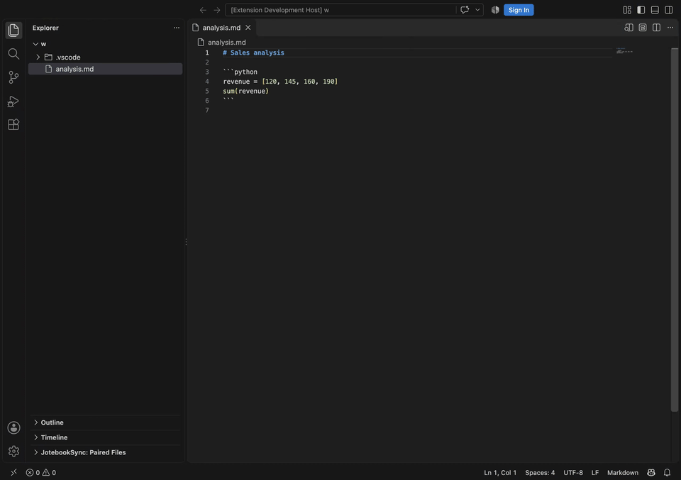

# JotebookSync

JotebookSync is a VS Code extension that uses Jupytext to pair Jupyter notebooks
with Python scripts, Markdown, and other text formats. It can sync paired files
on save and show what changed before you overwrite a representation.

## Quick start

1. Install [JotebookSync from the VS Code Marketplace](https://marketplace.visualstudio.com/items?itemName=moyarich.jotebooksync).
2. Open an `.ipynb` notebook and select **JotebookSync: Configure Paired Files…**
   in the Command Palette.
3. Choose a text format and create the pair.
   If Jupytext is missing, follow the extension’s prompt to install it in your Python environment.

## Documentation

See the [JotebookSync guides and command reference](https://moyarich.github.io/JotebookSync/).
See the [extension README](packages/JotebookSync/README.md)
[MIT license](packages/JotebookSync/LICENSE)
